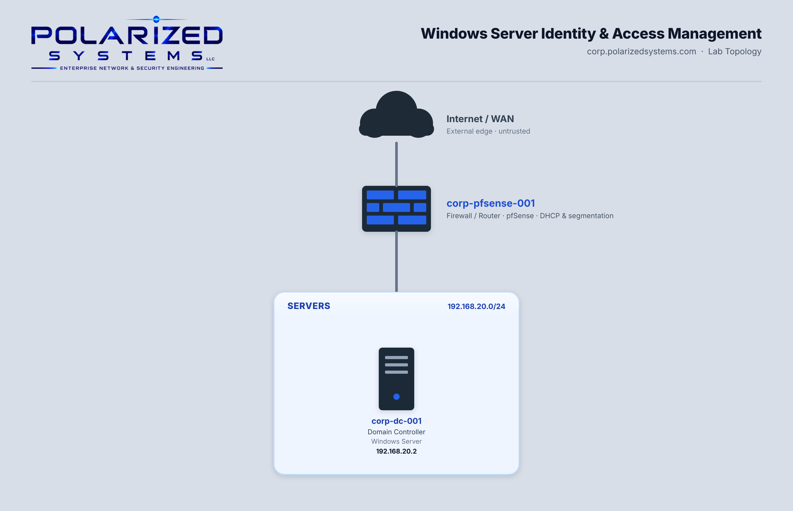

# Windows Server Identity & Access Management

Identity and access management comes down to one deceptively simple question: who is allowed to do what?

In a Windows domain the answer lives in Active Directory — every account, every group, every permission, and every policy that governs them.

Get it right and the right people have exactly the access they need, with a record of who did what; get it wrong and you've either locked out your own staff or handed an attacker the keys.

This lab works through the core of server-side identity and access management, hands-on, on a live domain controller.

All work was performed in **Polarized Systems**, my enterprise lab environment: a Windows Active Directory domain (`corp.polarizedsystems.com`) with segmented server, workstation and Security Operations subnets routed through a pfSense firewall.

---

## Lab Topology

---

## Exercises

| # | Exercise | What I Did | Key Tools |
|---|----------|------------|-----------|
| 1 | [Password & Account Lockout Policies](exercise-1-password-and-account-lockout-policies/README.md) | Defined and enforced a domain-wide password and account-lockout policy through Group Policy, then scoped and applied it | Group Policy · Password Policy · Account Lockout Policy · `gpupdate` |
| 2 | [User Accounts & Groups](exercise-2-user-accounts-and-groups/README.md) | Created an Active Directory user, configured account options, and granted access through security-group membership | Active Directory Users and Computers · Security Groups |
| 3 | [Permissions & Access Controls](exercise-3-permissions-and-access-controls/README.md) | Delegated a scoped set of user-management rights with the Delegation of Control Wizard — least privilege in practice | Delegation of Control · AD DS |
| 4 | [Auditing](exercise-4-auditing/README.md) | Enabled object-level auditing and two advanced audit policies (account-logon and account-management) via Group Policy | Advanced Audit Policy · Object SACL auditing · Group Policy |
| 5 | [Multifactor Authentication & Single Sign-On](exercise-5-multifactor-authentication-and-single-sign-on/README.md) | Explained the authentication-factor model and OAuth-based single sign-on — the identity concepts that extend password security | MFA · SSO · OAuth |
| 6 | [Data Security Concepts](exercise-6-data-security-concepts/README.md) | Covered boot-level security, data storage and encryption (at rest / in transit, symmetric / asymmetric), and the risk-and-cost side of protecting data | BIOS/UEFI · Encryption · TLS / VPN · Risk management |

---

## Skills Demonstrated

- Designing and enforcing password and account-lockout policies with Group Policy
- Creating and managing Active Directory user accounts and account options
- Implementing role-based access through security-group membership
- Applying least-privilege access with delegated administrative control
- Configuring object-level (SACL) auditing on Active Directory objects
- Deploying domain-wide account-logon and account-management audit policies
- Scoping and applying Group Policy, and forcing refresh with `gpupdate /force`
- Connecting identity controls to detection — the audit events feed the SIEM work in Security Operations
- Understanding the multifactor-authentication factor model and OAuth-based single sign-on
- Securing data across its lifecycle — boot-level protection, encryption at rest and in transit, and risk-based decision-making

---

## Related Portfolios

- [Security Operations](https://github.com/PolarizedSystems/Security-Operations)
- [Vulnerability Management](https://github.com/PolarizedSystems/Vulnerability-Management)
- [Incident Response](https://github.com/PolarizedSystems/Cybersecurity-Incident-Response)
