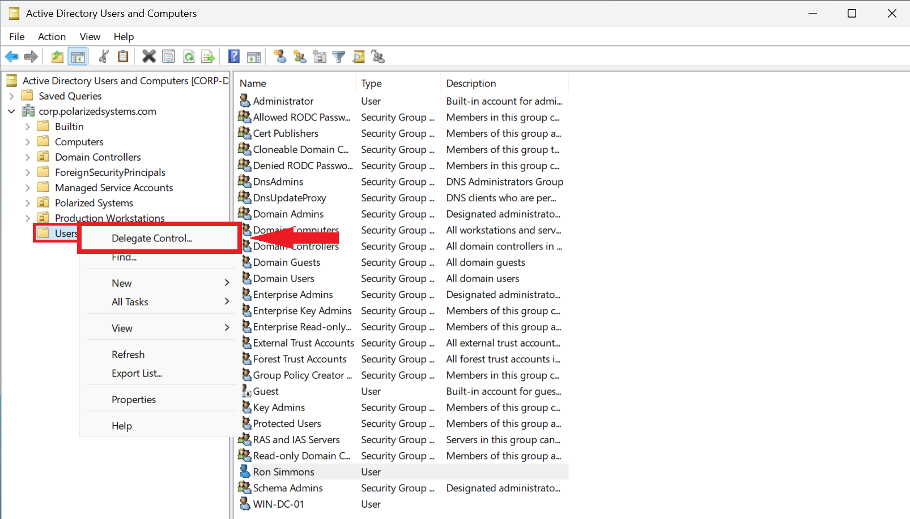
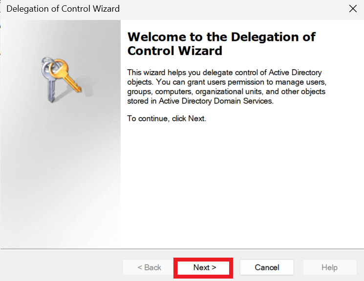
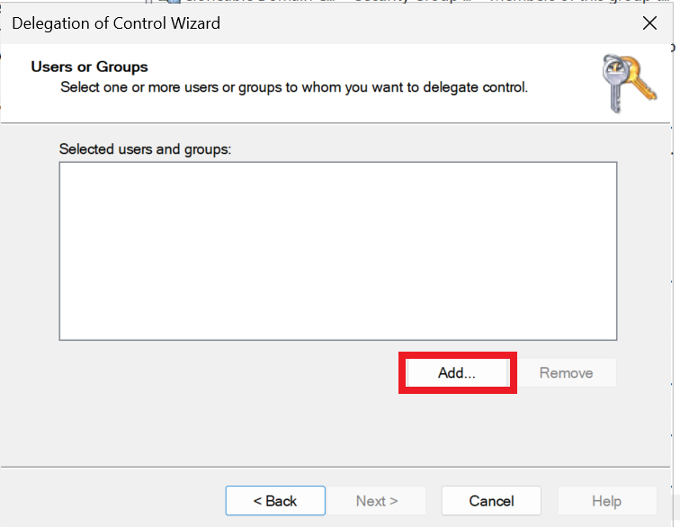
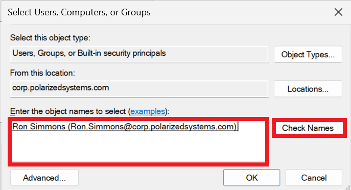
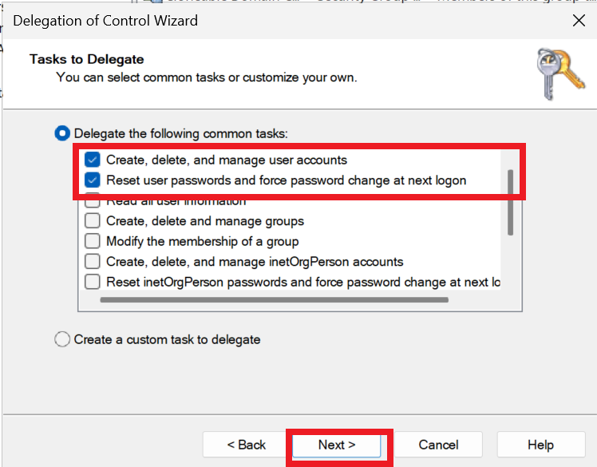
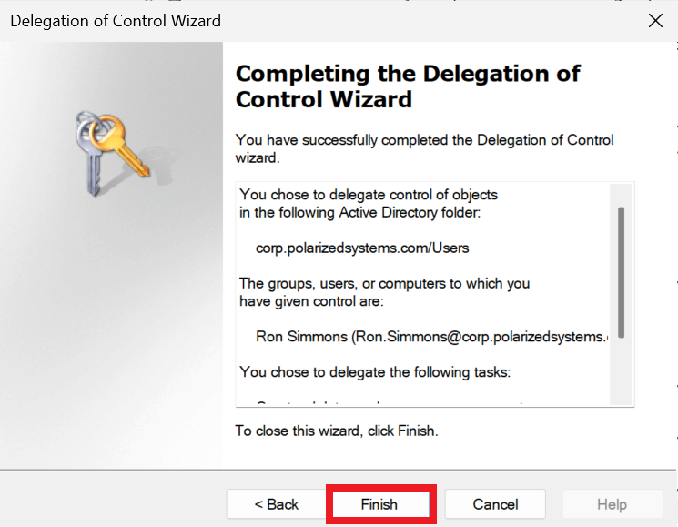

# Exercise 3 – Permissions & Access Controls

[← Back to Lab Overview](../README.md)

---

## Overview

Not every administrative task should require a full administrator. A help-desk technician who resets passwords all day doesn't need the keys to the entire domain — they need exactly enough authority to do that one job, and nothing more. Active Directory's **Delegation of Control** makes that possible: it hands a specific user or group a narrow, well-defined slice of administrative rights over a chosen part of the directory, without ever promoting them to Domain Admin.

In this exercise I delegated a focused set of user-management rights to an account, granting it the ability to create and manage users and reset passwords within a container — a textbook application of least-privilege access control.

> 🔎 **Delegation is least privilege in action.** Instead of adding a technician to a powerful group "so they can get their work done," delegation grants only the handful of permissions the role actually requires, scoped to only the objects it should touch. The blast radius if that account is ever compromised shrinks accordingly — a delegated password-reset account can't restructure the domain, because it was never given the rights to.

## Device

- **corp-dc-001** – Windows Server – Domain Controller / Active Directory Users and Computers (192.168.20.2)

---

## Task 1 – Delegate Control

1. In Active Directory Users and Computers, right-click the **Users** container and choose **Delegate Control**.

   

2. The **Delegation of Control Wizard** opens.

   

3. On the users-or-groups screen, click **Add** to choose who receives the delegated rights.

   

4. Select **Ron Simmons** as the delegate.

   

5. Choose the tasks to delegate — **Create, delete, and manage user accounts** and **Reset user passwords and force password change at next logon** — a tightly scoped grant, not blanket administrative power.

   

6. Finish the wizard — the delegated rights are now in effect.

   

> 🔎 **What this account can and can't do now.** Ron Simmons can create, manage, and reset passwords for user accounts in this container — the day-to-day work of a help-desk or junior admin. What he *can't* do is modify group policy, touch domain controllers, or alter the domain's structure, because none of those rights were delegated. That gap is the whole point: capability matched precisely to need.

---

> ### 🎤 Stakeholder Takeaway
>
> "Staff get exactly the administrative authority their job calls for — and not a scrap more. A technician can reset passwords and manage user accounts without ever being handed domain-wide control, so a mistake or a compromised help-desk login can't cascade into a full takeover. It's how we let people do their jobs efficiently while keeping the most powerful rights locked down to the few who genuinely need them."

---

[← Previous: Exercise 2 – User Accounts & Groups](../exercise-2-user-accounts-and-groups/README.md) | [Back to Lab Overview](../README.md) | [Next: Exercise 4 – Auditing →](../exercise-4-auditing/README.md)
